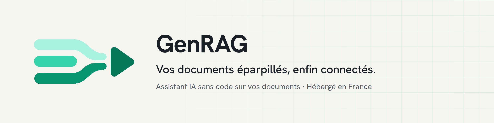

<a href="https://www.genrag.app">
  <picture>
    <source media="(prefers-color-scheme: dark)" srcset="banner-dark.png">
    
  </picture>
</a>

  
  
  
  

**GenRAG (pour *Generate RAG*) transforme les documents de votre entreprise en un assistant IA qui répond à votre équipe, sources à l'appui. Sans une ligne de code.**

### Comment ça marche
1. **Importez vos documents** : PDF, Word, pages web, ou directement depuis Google Drive, SharePoint, OneDrive et Notion.
2. **Assemblez votre assistant** : partez d'un modèle métier ou reliez des blocs dans GenRAG Studio, avec le modèle de votre choix à chaque étape, parmi plus de 400.
3. **Partagez-le à votre équipe** : chaque réponse cite le document et le passage d'où elle vient.

### Vos données restent les vôtres
- Hébergé en France, données et connexions chiffrées
- Aucun modèle d'IA ne conserve vos données : vos documents n'entraînent aucune IA
- Des modèles hébergés en Europe, au choix

👉 [Demandez votre accès à la bêta](https://www.genrag.app/contact) · [Sécurité](https://www.genrag.app/securite)
